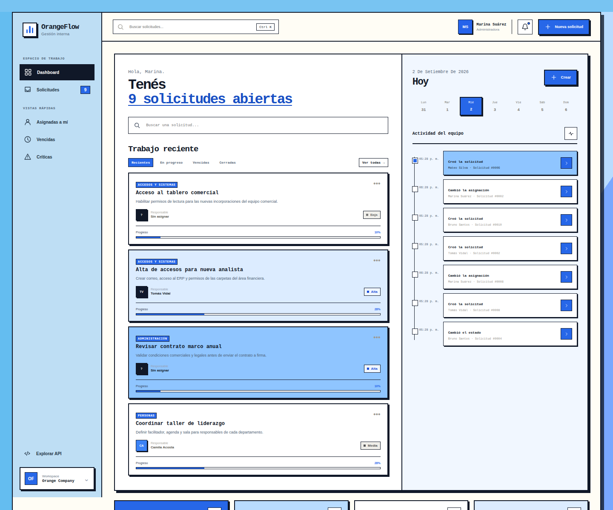

# OrangeFlow

OrangeFlow is a portfolio-grade internal request management system for organizations that have outgrown email threads, messaging apps, and shared spreadsheets.

It provides a single place to submit requests, assign ownership, manage priorities and statuses, discuss work, and retain a complete audit trail. This repository represents a realistic business case and technical implementation; it does **not** claim to have been built for, or deployed by, a real client.



## Why this project exists

Internal requests often arrive through disconnected channels. That makes it difficult to answer basic operational questions:

- What is still open?
- Who owns each request?
- Which items are overdue or critical?
- Why did a priority or status change?
- Which departments are generating the most work?

OrangeFlow turns those scattered interactions into a visible, searchable, and auditable workflow.

## Features

- Request creation, assignment, prioritization, and status management
- Comments and immutable change history
- Search, combined filters, and pagination
- Department, category, and assignee catalogs
- Overdue request detection and open-time metrics
- Dashboard with status, priority, department, and activity views
- Validated REST API with OpenAPI documentation
- Responsive Spanish-language interface
- Neo-brutalist editorial design system with a blue palette
- Versioned Alembic migrations and idempotent demo data
- Automated API and business-rule tests

## Technology

| Layer | Technology |
|---|---|
| Backend | Python, FastAPI, Pydantic |
| Persistence | SQLAlchemy 2.x, PostgreSQL |
| Migrations | Alembic |
| Frontend | Semantic HTML, CSS, vanilla JavaScript |
| Testing | pytest, HTTPX, SQLite in-memory fixtures |
| Delivery | Docker, Docker Compose, GitHub Actions |

No Node.js toolchain or frontend build step is required.

## Architecture

```text
Browser (HTML + CSS + vanilla JavaScript)
                     │ JSON / fetch
                     ▼
              FastAPI routers
                     │
        Request business service
          │ rules       │ audit
          └──────┬──────┘
                 ▼
          SQLAlchemy 2.x ORM
                 │
             PostgreSQL
                 ▲
          Alembic migrations
```

HTTP concerns stay in routers, request lifecycle rules live in a dedicated service, and persistence is handled through SQLAlchemy sessions. Every relevant mutation writes a history entry in the same transaction as the request change.

For a deeper explanation, see [Architecture](docs/ARCHITECTURE.md). The complete endpoint guide is available in [API reference](docs/API.md).

## Quick start with Docker

```bash
cp .env.example .env
docker compose up --build
```

Open:

- Application: <http://localhost:8000>
- Swagger UI: <http://localhost:8000/docs>
- ReDoc: <http://localhost:8000/redoc>

The application container waits for PostgreSQL, applies migrations, and loads the idempotent demo dataset before starting the web server.

## Local development

Requirements: Python 3.11+, PostgreSQL, and Git.

```bash
python3 -m venv .venv
source .venv/bin/activate
python -m pip install --upgrade pip
python -m pip install -r requirements-dev.txt
cp .env.example .env
docker compose up -d database
alembic upgrade head
python -m app.seed
uvicorn app.main:app --reload
```

If Docker is unavailable but PostgreSQL binaries are installed, OrangeFlow can create an isolated user-level cluster on port `55432`:

```bash
cp .env.local-postgres.example .env
./scripts/start.sh
```

Manage that local cluster with:

```bash
./scripts/local-postgres.sh status
./scripts/local-postgres.sh stop
```

## Request lifecycle

```text
new ──► assigned ──► in_progress ──► resolved ──► closed
          │               │              │
          └──► blocked ◄──┘              └──► in_progress
```

- Assigning a new request automatically moves it to `assigned`.
- A request needs an assignee before work can begin.
- Invalid transitions return `409 Conflict` with a stable domain error code.
- `resolved_at` is set when a request is resolved or closed and cleared when reopened.
- Open requests are overdue when their due date has passed.

## API overview

| Method | Endpoint | Purpose |
|---|---|---|
| `GET` | `/api/health` | Service health |
| `GET` | `/api/dashboard` | Metrics and recent activity |
| `GET` | `/api/requests` | Search, filter, and paginate requests |
| `POST` | `/api/requests` | Create a request |
| `GET` | `/api/requests/{id}` | Retrieve details, comments, and history |
| `PATCH` | `/api/requests/{id}` | Update and audit a request |
| `POST` | `/api/requests/{id}/comments` | Add a comment |
| `GET` | `/api/catalogs/departments` | List active departments |
| `GET` | `/api/catalogs/users` | List active users |
| `GET` | `/api/catalogs/categories` | List active categories |

`GET /api/requests` supports `search`, `department_id`, `status`, `priority`, `user_id`, `overdue`, `page`, and `page_size`. Status and priority parameters may be repeated.

## Tests and quality checks

```bash
pytest
ruff check .
```

The test suite uses an isolated in-memory database and covers request creation, assignment, status transitions, priority changes, resolution timestamps, comments, history, validation, combined filters, overdue detection, dashboard metrics, HTML delivery, and OpenAPI generation.

## Project structure

```text
app/
├── main.py                 # FastAPI application and web entry point
├── config.py               # Environment-based settings
├── database.py             # Engine, session, and declarative base
├── models.py               # SQLAlchemy entities and relationships
├── schemas.py              # Pydantic contracts and validation
├── seed.py                 # Idempotent demo dataset
├── routers/                # REST endpoints
├── services/requests.py    # Lifecycle rules and auditing
├── templates/index.html    # Application shell
└── static/                 # CSS, JavaScript, and favicon
alembic/                    # Versioned database migrations
docs/                       # Architecture, API reference, and screenshot
scripts/                    # Local development helpers
tests/                      # Integration and business-rule tests
```

## Configuration

| Variable | Default example | Description |
|---|---|---|
| `ORANGEFLOW_APP_NAME` | `OrangeFlow · Internal Request Management` | Application and OpenAPI title |
| `ORANGEFLOW_ENVIRONMENT` | `development` | Runtime environment label |
| `ORANGEFLOW_DEBUG` | `false` | FastAPI debug mode |
| `ORANGEFLOW_DATABASE_URL` | `postgresql+psycopg://...` | SQLAlchemy database URL |
| `ORANGEFLOW_ACTIVITY_LIMIT` | `8` | Dashboard activity item limit |

Never commit `.env` files or production credentials.

## Scope and security

OrangeFlow is a portfolio application, not a production-ready identity or authorization system. A real deployment should add SSO/OIDC, role-based access control, secrets management, rate limiting, object storage for attachments, structured observability, and automated backups.

See [Security policy](SECURITY.md) for responsible disclosure guidance.

## Contributing and license

Contributions are welcome through focused issues and pull requests. Read [CONTRIBUTING.md](CONTRIBUTING.md) before submitting changes.

Released under the [MIT License](LICENSE).
