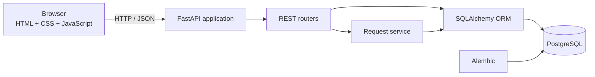
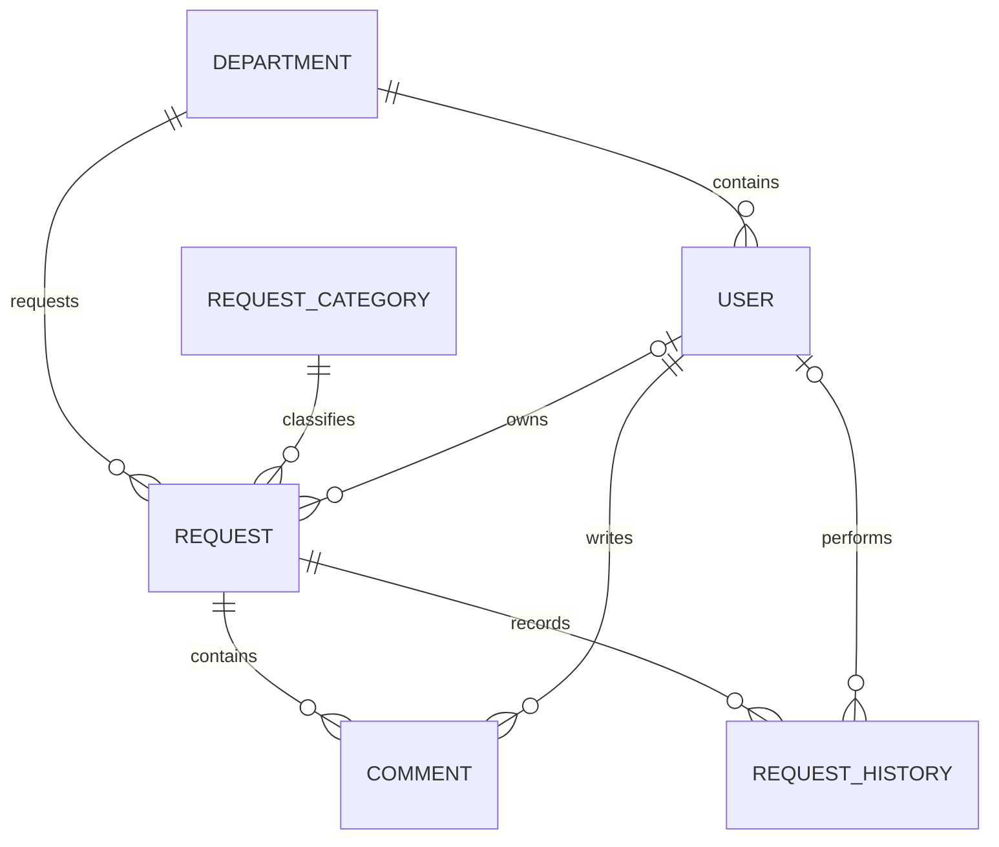
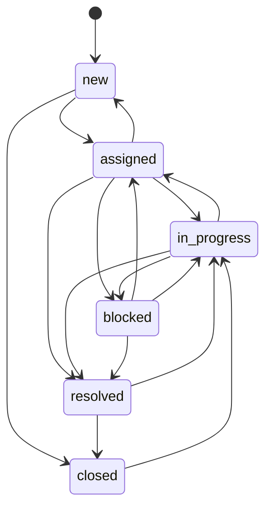

# Architecture

## System context

OrangeFlow is a compact monolithic web application. FastAPI serves both the browser shell and a JSON API, while PostgreSQL remains the source of truth for operational and audit data.

The architecture intentionally avoids a frontend build pipeline. This keeps deployment simple without coupling business rules to browser code.

## Components

### Presentation layer

- `app/templates/index.html` defines the semantic application shell.
- `app/static/css/styles.css` contains the responsive neo-brutalist design system.
- `app/static/js/app.js` handles navigation, rendering, filters, forms, and API communication.

The browser never owns business rules. It presents valid options and delegates final validation to the API.

### HTTP layer

Routers are grouped by capability:

- `catalogs.py` exposes active departments, users, and categories.
- `requests.py` handles request queries and commands.
- `dashboard.py` calculates operational metrics and recent activity.

FastAPI and Pydantic provide request validation, response serialization, and OpenAPI generation.

### Business layer

`app/services/requests.py` owns lifecycle rules, reference validation, assignment behavior, resolution timestamps, comments, and history creation.

Request mutations and their audit entries share one SQLAlchemy transaction. If either write fails, neither change is committed.

### Persistence layer

SQLAlchemy 2.x models six core entities:

Alembic is the canonical schema migration mechanism. Application startup does not call `metadata.create_all` outside the isolated test suite.

## Request lifecycle

An assignee is required before entering `assigned` or `in_progress`. Removing the assignee from an `assigned` request returns it to `new`; removing one from active work is rejected.

## Dashboard calculations

- **Open requests:** `new`, `assigned`, `in_progress`, and `blocked`.
- **Overdue requests:** open requests whose `due_at` value is earlier than the current UTC time.
- **Resolved this month:** requests with a `resolved_at` timestamp in the current UTC month.
- **Average open time:** mean age, in hours, of all currently open requests.
- **Department workload:** open requests grouped by requesting department.

## Configuration

Settings use environment variables through `pydantic-settings`. Configuration is loaded once per process and passed indirectly through the database and application modules.

Secrets are never stored in source control. `.env.example` contains development-only values.

## Testing strategy

API tests override the database dependency with a SQLAlchemy session backed by an isolated in-memory SQLite database. This keeps the suite deterministic and fast while production and Docker execution use PostgreSQL.

Tests focus on externally observable behavior and domain invariants rather than implementation details.

## Production gaps

The current architecture is appropriate for a portfolio project and an internal prototype. A production rollout should add:

- OIDC or SAML single sign-on
- Role- and department-based authorization
- Request attachments in object storage
- Background jobs for notifications and integrations
- Rate limiting and structured audit export
- Centralized logs, metrics, tracing, and alerting
- Backup, restore, retention, and disaster recovery procedures
